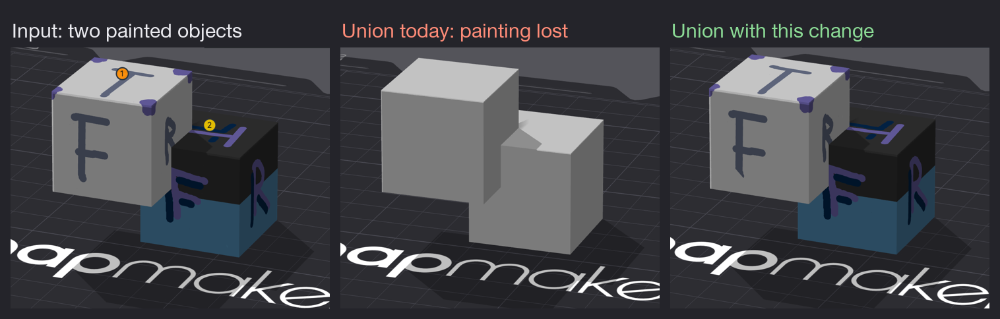
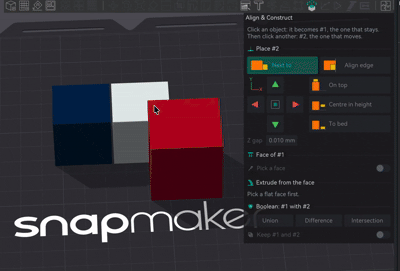
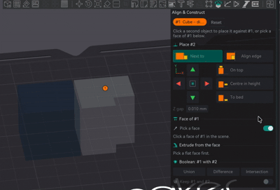
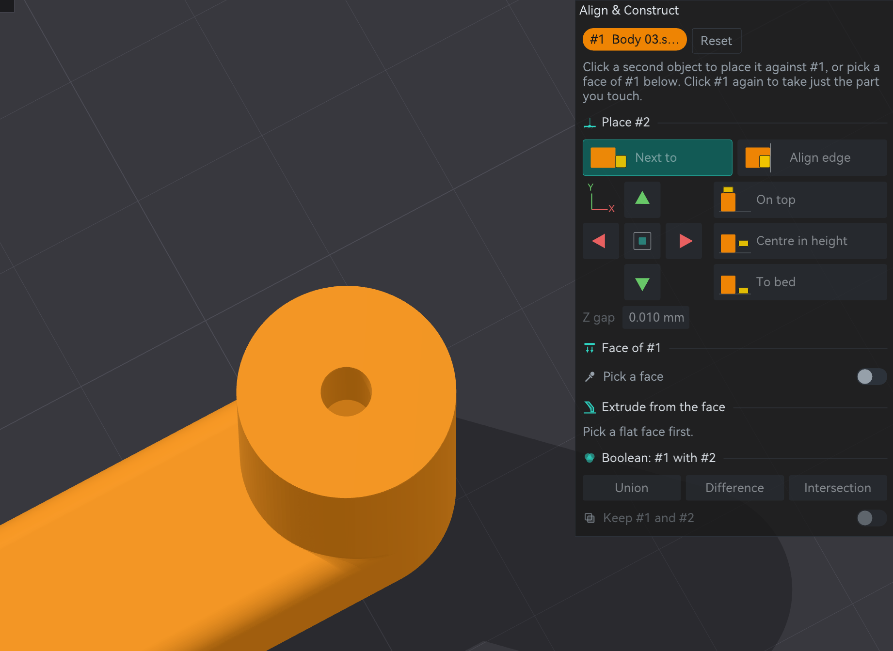
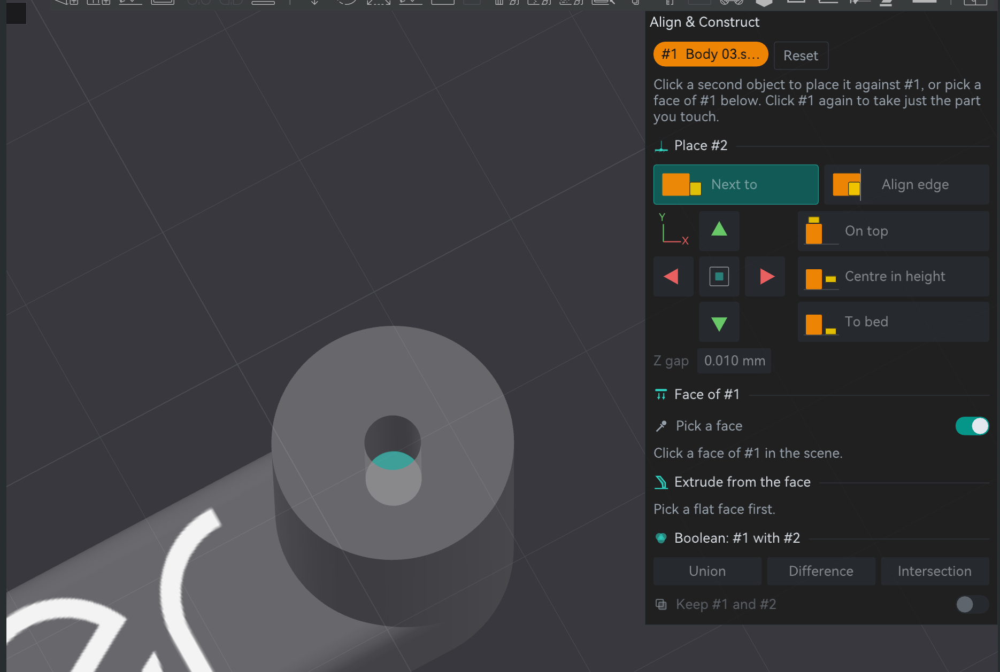
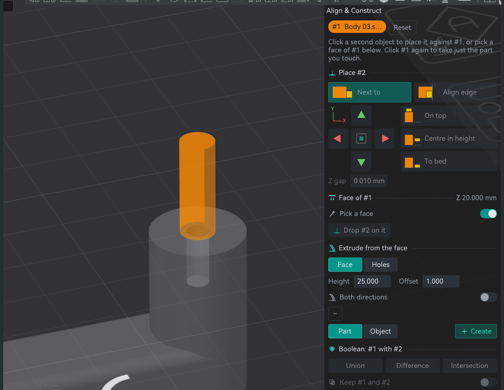
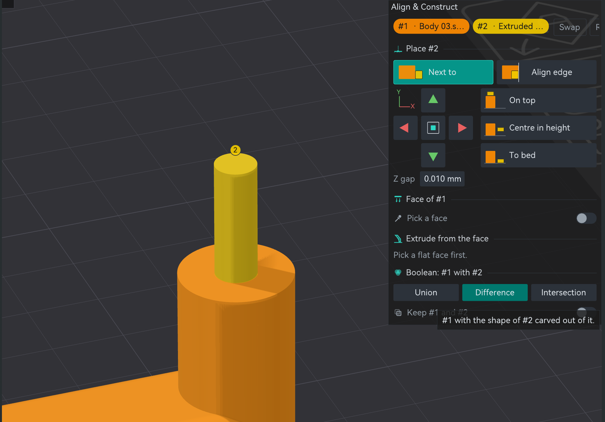
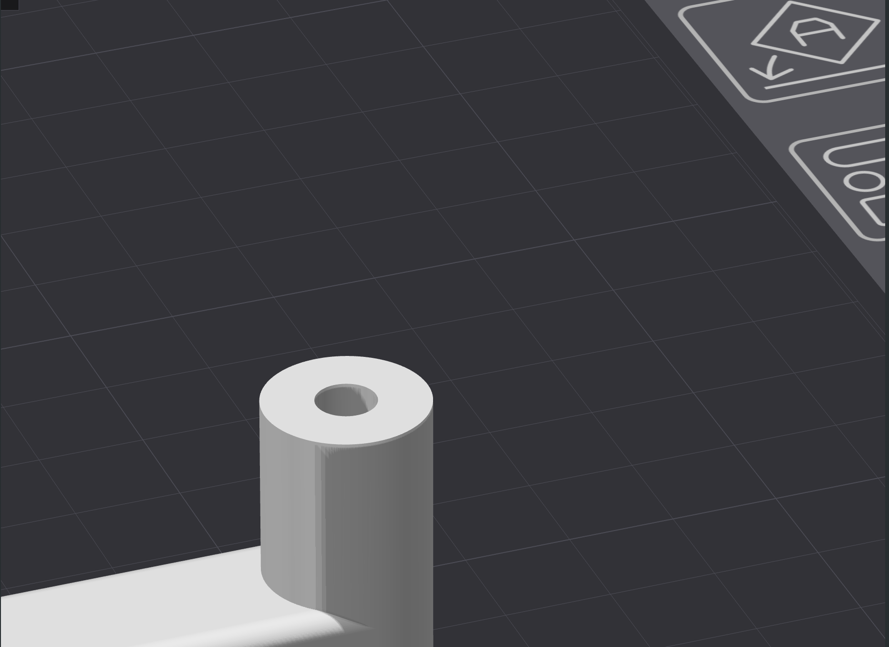

## Proud to announce that @Snapmaker is officially sponsoring this project!!

Development is conducted in close collaboration with the Snapmaker ecosystem and with Radoux/Radu, author of FullSpectrum and now part of the Snapmaker team.
By Neotko — inventor of Ironing/Neosanding (Ultimaker Cura, PrusaSlicer)

---

# Neotko 2.4.8 — on Snapmaker Orca 2.4.0 — Release Notes (draft, in progress)

> ⚠️ **Review your generated Gcode before long or production prints, especially if you
> turn on any of the features below.**

**2.4.8 is an incremental release on top of 2.4.7** (see `NEOTKOCM_RELEASE_2_47.md` and earlier
notes for the full feature set).

---

## What's new in 2.4.8

### Stickers have their own tab

**Where**: ColorStitch Painter → new **Stickers** tab, the last one in the bar.

Stickers used to live in a fold at the bottom of Palette. Now:

- **Load SVG…** sits next to the Sticker tool and only shows while the tool is on.
- The **Stickers** tab shows the options of the SVG you just loaded (side, background, gradients, colours) and
  the **layers**: every sticker on the object, the top one first (it covers the ones below). Each row is one
  line: colour, side (▲ top, ▼ bottom), name, eye, move up and down, edit, duplicate and remove.
- **Edit** opens that sticker's controls right below the layers and lets you drag the sticker on the model to
  move it.

Opening the tab turns the Sticker tool on, and leaving it gives you back the tool you had. Every change can be
undone with Ctrl+Z: placing, moving (one drag is one step), rotating, resizing, mirroring, changing side,
reordering, duplicating, renaming, hiding, recolouring and removing. Before, none of them could.

All stickers are visible, inside the painter and in the normal 3D view, under the same switch as painted
colour (**Keep paint visible outside this gizmo**). The preview is cut to the face the sticker sits on, so the
part hanging outside the object, which never prints, no longer covers other objects.

### Editing a sticker

Press **Edit** on a layer and a block called **Sticker: name** opens under the layers, inside the same tab. No
floating window to move around: click its title to fold it when you need room, and press **Edit** again or pick
another layer to switch. It has two tabs, **Place** and, on multicolour stickers, **Colours**.

**Place**

- **Side**: Top or Bottom (see below). Changing it moves the sticker to the face on the other side, at the same
  spot, and turns the camera to look at it.
- **Rotate** and **Size**. Size is a percentage of the object: 100 % fits on its face with a small margin, so the
  size of the original SVG file doesn't matter. **Fit to object** centres it and sets it to 100 %.
- **Mirror ↔** and **Mirror ↕**.
- **Restore proportion**: a sticker lives on the object, so if you scale the object unevenly after placing it,
  the sticker stretches with it. The block then says how much (**Stretched 12 %**) and this button gives it
  back its own shape at the same average size. Any edit of the sticker also keeps its shape.
- On a one-colour sticker, the recipe it uses and **Use Palette colour**.

**Colours** (multicolour stickers): see below.

### Multicolour SVG stickers

Load an SVG with several colours and each colour gets its own recipe, made from your four filaments:

- **Flat**: solid passes, the closest match the filaments can reach.
- **ColorStitch**: two filaments alternated line by line in a single pass. It also works on bridges.

Near-identical colours (antialiasing, exporters that write #FE0000 and #FF0000) are one colour. A gradient is
always its own colour, even if its average looks like one of the flat colours of the drawing. Inside one SVG, a
shape drawn later covers the ones under it, the same as in any vector editor. Untick **Use the SVG colours** for
the old behaviour: the whole SVG takes the colour selected in Palette.

The **Colours** tab is one column, so the panel doesn't get wider:

- On top, **what the SVG asks for** and, below it, **what your filaments give**. Click the drawing to work on
  the colour under the mouse. While you do, that colour pulses on the model and the rest dims.
- Then a **row of squares**, one per colour of the drawing: the top half is what the SVG asks for, the bottom
  half what prints. An amber dot marks a colour that is clearly off. Hover one to see the difference (dE) and
  how many parts it has, click it to pick it.
- The **picked colour** comes next: its eye (a hidden colour is not printed and you see what is underneath),
  what it is (flat colour or gradient) and its **recipe** drawn the way Pro draws it (Top, Penultimate, Bottom).
  A gradient shows the ramp it asks for and the parts it prints as; click a part to pick it.
- **Edit in Pro** opens that recipe in Pro; the sticker changes as you edit. Pro shows **Back to sticker** to
  return to where you were, and leaving Pro any other way closes the sticker. Copies of a sticker share their
  recipes.
- **Use Palette colour** gives the colour selected in Palette to that colour, or to several at once
  (Ctrl/Shift-click squares to mark them).
- **Other recipes, closest first** is folded: open it to see the two automatic ones (Flat and ColorStitch) and
  your saved colours, closest first. Hover one to see its recipe before you pick it.
- At the bottom, in two lines: how many recipes the sticker uses, a maximum, and **Reduce**, which merges the
  two most alike recipes again and again until it fits (more recipes mean more tool changes and more purge).
  Below, **Recompute all** makes every recipe again as Flat or as ColorStitch.

> ⚠️ The 3D preview of a sticker shows each colour as a flat swatch. A ColorStitch weave or a smooth gradient is
> not drawn on the model yet; the slice uses the real recipe.

### SVG stickers print what you see

Stock SVGs (Illustrator, Freepik and the like) now come in the way they look in a viewer:

- **Colours set with CSS classes** are read. Before, an Illustrator SVG often came in as a single black colour.
- **The background is removed**: a shape that covers the whole drawing is dropped, so the sticker is only the
  drawing. Tick **Keep background** if you want it printed.
- **See-through shapes are merged** into solid colours with what is under them (a print can't be transparent).
  Shapes at 80 % opacity or more count as solid. The panel tells you how many were merged.
- **Everything is cut to the SVG canvas**, as a viewer does. Drawings that spill outside their page no longer
  grow the sticker.

> SVGs whose drawing is a **pattern fill** (the shapes live inside a `<pattern>` and one rectangle is filled with
> it) can't be imported: there are no shapes to read. In Illustrator, **Object → Expand** the fill and export
> again.

### Gradients in SVG stickers

Linear gradients in an SVG print as gradients, in the direction and length the SVG gives them. They turn with
the sticker. Any number of colour stops works. Radial gradients still print as their average colour.

- **Gradients as bands** (on by default): the gradient is cut into flat bands (**N bands**, 4 to 32, default
  12) and each band gets the closest recipe your filaments can make. Neighbouring bands share a recipe unless a
  change is clearly closer, so they follow the gradient instead of flickering between two similar recipes.
  Bands next to each other with the same recipe make one **part** (A, B, C… in the Colours tab).
- Click a part to see and change its recipe. **Split** cuts a part in two and gives the second half its own
  recipe. **Join with next** gives the next part this part's recipe.
- **Make it a smooth ramp** turns the gradient into one ColorStitch ramp between two filaments, and back.

### Stickers on the bottom face

A sticker can go on the **bottom** of an object: the face on the bed (first layer) or the underside of an
overhang or bridge.

- Pick **Side: Bottom** next to the loaded SVG. The camera turns to look from below.
- Click the object from wherever you like: the sticker lands on the flat face of its side at that spot. With
  Bottom, a click on the top face goes to the face underneath. Moving it slides it along that face. Faces tilted
  more than about 11° are not used.
- A bottom sticker prints with the **Bottom** zone of its recipes. Its automatic recipes are made for it: the
  colour is worked out as seen from the bed (the first layer printed is the one in front), within the Bottom
  limits (two Solid passes and one ColorStitch). They are saved as "… (bottom)".
- A one-colour sticker whose recipe has no Bottom zone shows a warning and **Make a Bottom version**.
- Top and bottom stickers on the same object don't get mixed up: each layer only takes the stickers of its side.

With a bottom sticker or bottom paint on the bed face, the first layer is printed in several passes before the
normal first layer starts. The wipe tower and the first-layer settings now handle that, see **Bottom on the bed:
first layer and wipe tower** under Fixes.

### Colour preview: line by line

The colour the painter predicts for a recipe (Pro, Palette, the sticker recipes and the 3D view) is now worked out
line by line: in a ColorStitch or PathBlend pass, every line keeps its own filament and its own TD on top of what
is under it. Before, the pass was averaged into one colour **and one TD**, and transparency doesn't average: an
opaque line next to a see-through one is not two half see-through lines. Recipes with ColorStitch between
filaments of very different TD change the most. Solid-only recipes give the same colour as before. The G-code
doesn't change.

**Up close**: the **Result** square in Pro and in the sticker's Colours tab shows the recipe up close on top (each pass
with its own angle and pattern, Top crossing Penultimate, each line with its TD) and the colour you see from a
distance in a strip below.

### Palette: hover card

Hovering a colour in Palette shows a small card: the zones of the recipe on the left (Top, Penultimate, the
object, Bottom, each with its real pattern), the recipe up close on the right with the colour from a distance
below it, and the angle on top. The same card shows when you hover a part, a colour or another recipe in the
sticker's Colours tab.

---

### Booleans and Split keep the painting

**Where**: the **Mesh boolean** tool, **Mesh boolean** in the right-click menu of an assembled object, **Split**
> **To Parts** and **Split** > **To Objects**, and the Boolean of **Align & Construct**.

Until now all of these threw the painting away. You painted a model, merged two parts or split it in pieces,
and it came out in one plain colour. Now it stays:

- Every stroke stays where it was: colour, fuzzy skin, support and seam painting.
- When you merge parts, the skin you never painted keeps the filament of its own part, mixed filaments too. The
  merged object looks like the parts did.
- **Part 1 (or #1) gives the base filament of the result**, the one that fills the inside. In a Union, pick the
  big part as Part 1. If you pick a small part with another filament, the whole inside prints with that one.
- In a **Difference**, the walls of the cut take the base filament.
- **Split** copies the painting of each piece triangle by triangle, so it comes out exactly as you painted it.

On a big painted model it can take a few seconds, and a small window says **Keeping the painting...** while it
works. Measured on my Mac: a 218k triangle sea slug with all its skin painted merges in about 9 s, and a dragon
of 32 pieces splits in 1.4 s, about what the split alone takes. The merged sea slug slices to the same G-code as
the assembled one: same tool changes, 0.06 g apart.

ColorStitch recipes, Texture Bump zones and stickers do not carry over yet.

Radu asked for this one. It is also up as clean commits for FullSpectrum and for Snapmaker Orca 2.4.0, in case
they want it.

---

### Align & Construct: see where it lands, and build parts

**Where**: the **Align & Construct** tool in the top toolbar. It is the tool that used to be called Align &
Stack, with a new panel and new jobs. It no longer needs LibreMode: everyone has it.

#### What it does

- **Place** one object or part against another: next to it, on top, centred, or with an edge lined up.
- **Extrude** any flat face of a model into a new solid, grown or shrunk around its outline.
- **Boolean**: join, cut or intersect two objects, or two parts of the same object, without assembling them first.
- It works **inside an assembled object**: you can pick a single part of it and leave the rest where it is.

#### How to use it

Click an object and it becomes **#1**, the one that stays. Click another and it is **#2**, the one that moves.
**Swap** trades them.

**Picking a part of an assembly.** The first click takes the whole object. Click it again and you get just the
part under the mouse. A third click on that part lets it go. The chip at the top shows a dot before the name
when it is a part, and the rest of the assembly turns see-through so the part stands out. #1 and #2 can be two
parts of the same object. What you picked gets a layer of its colour (orange for #1, yellow for #2), painted
models too.

**Place #2** puts one against the other.

- A pad of four arrows, drawn as the bed seen from above, with a centre button in the middle. The arrows follow
  the bed axes, like moving an object in Orca: red is X, green is Y.
- Three buttons for height: **On top**, **Centre in height** and **To bed**.
- **Next to** leaves #2 beside #1, touching it. **Align edge** moves #2 until its edge on that side lines up
  with the same edge of #1. Each has a small drawing of what it does.
- **Hover any of those buttons and #2 shows up as a ghost where it would land**, with a dotted line from
  where it is now to a target mark. The line and the mark keep their size on screen, so a 3 mm part is as easy
  to read as a big one. Click, and it lands exactly there.
- A part moves inside its own object, so it stays in the assembly. Without LibreMode, a whole object you lift
  up still drops to the bed, as everywhere else in Orca.

**Face of #1** works on a flat face you pick.

- Turn on **Pick a face** and click a face of #1. A flat face lights up whole, holes included.
- **Drop #2 on it** rests #2 at the height of that face.

**Extrude from the face** makes a new solid out of that face.

- Any flat face works, at any angle. The solid grows straight out of it, along the face's own direction.
- **Face** extrudes the face as it is. **Holes** extrudes only its holes, filled: pick the flat face around a
  screw hole and you get the plug of that hole.
- **Height** is how thick the new solid is, 5 mm to start. **Offset** grows its outline, or shrinks it with a
  negative value.
- **Both directions** splits the height: half grows out of the face and half goes into the model, so the new
  solid passes through the face without you having to move it. Handy as a cutter for a boolean.
- A preview shows what you will get before you commit.
- **Part** puts it inside the same object, in place. **Object** makes a separate object.
- **Create** does it. One undo removes it.

The new solid is a normal mesh: if you change the model afterwards, make it again.

A real use: a 0.05 mm sheet of white over the stickers of a keyring, to soften very opaque matte colours. It
used to mean going back to the CAD program. Now it is a click on the top face.

**Boolean: #1 with #2** joins or cuts.

- Press **Union**, **Difference** (#1 with the shape of #2 carved out) or **Intersection**.
- Two separate objects: the result is a new object in the same place.
- Two parts of the same object: the result is a part of that object, in place, so the assembly stays together.
- With **Keep #1 and #2** off the result replaces both, with it on they stay.
- If the two do not overlap, or one is not a closed solid, it tells you and leaves the scene alone.

The result keeps the painting of both, and the unpainted skin of each one keeps its filament (see
**Booleans and Split keep the painting** below). It does not keep the stickers, the ColorStitch recipes or the
per-part settings of #2.

#### Example: a looser hole for a screw

A downloaded cabinet handle ([Modern minimal cabinet handle](<https://space.snapmaker.com/en/model/40043-modern-minimal-cabinet-handle-125mm-furniture-pull>))
whose screw holes come out too tight. No CAD needed:

1. Open **Align & Construct** and click the handle. It becomes #1.

2. Turn on **Pick a face** and click the floor of the hole. The rest of the model turns see-through, so you can
   see inside it.

3. In **Extrude from the face**, set **Height** to 25 and **Offset** to 1 (1 mm wider all round, big on purpose
   so it shows), keep **Part** and press **Create**. A peg 1 mm wider than the hole appears inside it.

4. Click the handle again to take just its body as #1, then click the peg: #2. Press **Difference**.

5. The handle comes back as one part with a wider hole, in its place.

Things that changed from the old tool:

- **To bed** drops #2 only. It used to drop every object you had picked.
- The centre button centres #2 on #1 in X and Y together.
- **On top** leaves #1 where it is. The "#1 to bed first" checkbox is gone.

---

### Stacked objects: real layers

**Where**: **Prime tower**, with **Tower type** NeoTower and **Variable layer height** ticked. It
also needs **LibreMode: On**, with parts resting on other parts (right-click → **Snap & Drag** puts them there).

A slicer lays every object on one grid of layers that starts at the bed. That is fine for a part on the bed. A
part resting on top of another one starts wherever the grid happens to fall, which can be up to half a layer
above or below the surface it sits on. Above, you get an air gap and the first layer comes out as a bridge.
Below, it digs into the part underneath. And the part underneath has the same problem at its top: a 2.3 mm
part at 0.2 stops at 2.25, so whatever sits on it hangs 0.05 in the air.

The usual workaround was nudging the layer height by a few hundredths (0.21 instead of 0.2) until a layer
boundary landed on the right height. It worked until you moved or resized anything.

With **Stacked objects: real layers** ticked:

- A part that does not touch the bed starts its layers at its own base. The empty stretch between the first
  layer and that base is split into equal layers that end exactly there. Nothing prints in it, so nothing is
  distorted.
- From its base up, the part uses its real layer height. 0.2 stays 0.2.
- A part with another object resting on its top prints up to its real height. Its last five layers change by
  a few hundredths to get there. The first layer is never touched.
- It follows the scene. Put a part on top, take it off or move it, and the parts involved are sliced again.

So you can stack parts with different layer heights, move them, change their size, and they still meet. A real
case from this release: a keyring with a 2.3 mm base at 0.2, a 0.05 mm sheet of white over its stickers, and
the frame and the lettering on top at 0.2. Every part lands on the one below, no gap, no bridge, no decimals,
and nothing to set by hand: the sheet between two parts even takes its own 0.05 without touching its layer
height.

We think a slicer should print what you built, where you put it. This is one more step in that direction.

Things to know:

- It is off by default, and it only shows with NeoTower and **Variable layer height**. Those two are
  what lets the tower follow objects whose layers are at different heights.
- It adjusts the top of a part, its highest point. Something resting on a lower step of the part is not
  covered yet.
- A sheet with nothing on top of it still needs its own **Layer height**.
- **"Conflicts of G-code paths"** can show up when stacked parts use different layer heights. The check
  assumes every part shares the same layers and compares two that are not at the same height. If the G-code
  preview looks right, it is right.

With the box off, with the Classic tower, or with a raft, layers are placed as before.

---

## Fixes in 2.4.8

### LibreMode: crash when slicing with Support Cubic, Adaptive Cubic or Lightning infill

**Where**: LibreMode on, Sparse infill pattern set to **Support Cubic**, **Adaptive Cubic** or **Lightning**.

With LibreMode on, a new object with one of those three infills closed the slicer as soon as it sliced. LibreMode
skips the internal bridges, and that step also prepares the data those three infills are built from, so they
were left with nothing. The data is prepared again now, and LibreMode still makes no internal bridges.

Big thanks to **naldo29** for reporting it in [issue #3](https://github.com/sebsucmor-alt/OrcaFS-NeotkoCM/issues/3),
with clear steps to reproduce it and even the cause. Reports like this one save a lot of time, so if something
breaks for you, open an issue too, it really helps.

### Mesh boolean: the result stays in place

After a **Mesh boolean**, the result moved so that its centre sat where the centre of Part 1 was. On two parts
that only partly overlap it jumped to one side. It stays where the parts were now.

### Slicing crawled at 35 % on big models with nothing painted

On a model with a lot of triangles (I hit it with one over a million) "Generating infill toolpath" could sit
at 35 % for minutes. The slicer was rebuilding the whole mesh on every layer to ask if anything was painted
for ColorStitch, with nothing painted. It skips that now. A painted model of that size is still slow, that
part is not fixed yet.

### ColorStitch: small pieces came out in the object's colour

**Where**: any surface painted or stickered with a ColorStitch recipe.

When a piece was too small for ColorStitch to alternate filaments (all its lines shorter than the minimum, or
fewer than two lines), its lines were left without a filament and fell back to the object's own filament. On
lettering and detailed stickers that looked like holes. They now take the first filament of their recipe.

The default **Minimum line length (ColorStitch)** is now **0.5 mm**. Presets that already store a value keep it;
if yours says 3 mm, small details will still fall back to one filament, so lower it.

### ColorStitch with a one-filament pattern

**Where**: any surface painted or stickered with a ColorStitch recipe whose pattern uses a single filament
(`33`, `333`…).

A pattern like that needs no alternating, but it wasn't printed with its filament. It was swapped for the four
filaments of the print profile, so you got stripes in colours you never asked for. Fixing that showed a second
problem: when every line of a surface ended up on the same filament, the lines were printed with the object's own
filament instead. A one-filament pattern now prints with that filament, and the wipe tower plans the same one.

### ColorStitch gradients on stickers follow the whole colour area

A gradient on a sticker used to restart on every separate piece (each letter, each fragment cut by another
sticker), so it looked like stripes. It now runs across the whole area of that colour, in one direction for all
the pieces.

### ColorStitch gradients on stickers ramp evenly

A sticker gradient started each piece with a run of one filament and then ran short of the other, so it looked
patchy. The gradient is now worked out over the whole colour area at once, and two pieces that share a line give
it the same filament.

### Sticker with a wall-recolouring recipe no longer recolours the whole wall

A recipe with **perimeter override** on a sticker recoloured the whole ring of walls of the object, even for a
small sticker in a corner. Stickers ignore it for now and the sticker's
Place tab shows a warning.

### Sticker tab: clicks and undo

- With no SVG loaded, clicking another object selects it (clicks used to be swallowed).
- A click that doesn't move a sticker no longer leaves an empty undo step.

### Pro: the saved colour of a recipe was one change behind

Pro saved the colour of a recipe from before your last change. Pro itself always showed the right one, but the 3D
view, the stickers and anything else that reads the saved colour could show the previous one. It now saves the
colour after the change, and the saved colours of all recipes are refreshed when filaments, TD or the list of
recipes change.

### ColorStitch sticker recipes showed colours the filaments can't make

A sticker recipe made as ColorStitch, or as a smooth gradient, kept the colour of the SVG as its preview colour
instead of the colour it prints. The 3D view showed blues with no blue filament loaded, and the recipe claimed a
perfect match (dE 0). It now shows the predicted colour and the real difference.

### Overlapping stickers no longer leave unprinted slivers

Where one sticker covers another, the cut left strips thinner than a line that printed nothing. Strips smaller
than about one line are now merged into the neighbouring piece they touch.

### ColorStitch: the two colours no longer print in pieces

**Where**: any Top surface or Penultimate with a ColorStitch recipe.

A ColorStitch surface prints one filament and then the other. Which one went first used to depend on where
the first line of each island happened to fall, so changing the line width could flip it. When a layer had
several islands and they disagreed, the surface was printed in four or more turns (one colour, the other,
back again) and the stacking of the lines changed from one island to the next.

Now the recipe decides: its first filament always prints first, on every island, and each colour is printed
in a single turn. To swap the order, swap the recipe (`13` becomes `31`).

Heads up: a project that printed the second filament first by chance will now print the first one first.

### ColorStitch on Penultimate came out scrambled

With the Penultimate angle on auto, the lines were laid in one direction and the colours were handed out as if
they ran in the other, so the stripes broke into patches. Penultimate now reads the direction from its own
lines, the same way Top does. A fixed angle on Penultimate already worked and is the same as before.

### ColorStitch: use Monotonic line

ColorStitch works best with **Monotonic line** on Top surface and on Penultimate. The plain Monotonic pattern
joins lines together and ColorStitch has to cut them apart again. That is better than it was, but a few lines
can still lose their colour. Slicing now shows a yellow warning when that happens.

### Bottom on the bed: first layer and wipe tower

With a bottom sticker or bottom paint on the bed face, the passes of the bottom face are printed before the
normal first layer starts. Three things went wrong there:

- **The first tool change missed the tower.** The tower planned it from the object's filament while the print
  started from another one, so the change was done without its purge. Now the tower and the print agree on the
  starting filament and the change is purged in the tower like any other.
- **The bottom face printed at full acceleration.** Those passes used the normal acceleration (10000 on the U1)
  instead of the first-layer one (500), together with the normal jerk, speed and nozzle temperature. They now use
  the first-layer values, which matters for bed adhesion.
- **The tower had no base and no brim.** Its first layer was a few loose strips on the bed, some printed at a
  fraction of the layer height. Now the first visit to the tower lays a full first layer over the whole tower
  area, with its brim, and the rest stands on it.

Prints without anything bottom-painted on the bed face are unchanged.

### Importing a 3mf keeps its recipes and stickers

**Where**: drop a 3mf on an open project and choose **Import geometry only**, or **File → Import**.

Importing a project that had Sandwich recipes, ColorStitch paint or stickers into your current work came out
plain when sliced, and it could also break what was already on the plate. Three things were wrong:

- **The palette was replaced.** Reading the file swapped your recipes for the ones in the file, so the paint and
  stickers you already had lost theirs.
- **Loading as one object dropped the stickers.** When a file has several objects at different heights, the
  **Multi-part object detected** question appears. Answering **Yes** built a new object without them.
- **Stickers ended up off the model** after that new object was centred on the plate.

Now the recipes used by what you import are added to your palette as **copies**, next to the ones you had. This
is on purpose: you can import the same file again, change the colours of the copy, and the original stays as it
was. Stickers and painted areas come along and stay in place.

Print and object settings still do not travel with an import (layer heights, shells and so on). To get those,
open the file as a project.

### Copy and paste keeps the stickers

**Where**: any object with stickers, Copy then Paste.

The pasted copy came out without its stickers. It also lost the Texture Bump projection plane. Both travel
with the copy now.

### "Wipe tower generation failed" with objects whose layers almost line up

**Where**: NeoTower, several objects with adaptive layer heights, Sandwich on at least one.

When a normal layer of one object and a Sandwich pass of another fell within a micron of each other, the slicer
asked the tower for two toolchanges on one layer and the tower had filed the second one under the next. The
export stopped with "Wipe tower generation failed, possibly due to empty first layer", which had nothing to do
with the first layer. It now finds that toolchange by its pair of tools and prints it where it is asked for.

### Switching back to the Classic tower after NeoTower

**Where**: Print settings → Prime tower → **Tower type**.

If you sliced with NeoTower and then changed the tower type back to Classic, the Classic tower came
out broken until you restarted. It slices right the first time now.

### Real Color and Filament legend: text no longer piles up

**Where**: Preview → view type **Real Color** or **Filament**, the legend in the corner.

On some computers the legend showed the headers and the filament rows on top of each other: "Usage" printed over
"Filament", and the metres and grams over "Extruder 1". On others it looked right after a short flicker. The
legend was reading the position of a column it had never measured, so the result depended on whatever was left
in memory. Both columns are measured now and the legend is laid out right from the first frame, on every system.

---

## Reference commits

Booleans and Split keep the painting, and Align & Construct, are also up as clean commits for other forks to
take. Same changes, without the Neotko-only parts.

- Snapmaker Orca 2.4.0: branches [keep-painting-sm240](https://github.com/sebsucmor-alt/OrcaFS-NeotkoCM/tree/keep-painting-sm240) and [align-construct-sm240](https://github.com/sebsucmor-alt/OrcaFS-NeotkoCM/tree/align-construct-sm240)
- FullSpectrum: branches [keep-painting-fullspectrum](https://github.com/sebsucmor-alt/OrcaFS-NeotkoCM/tree/keep-painting-fullspectrum) and [align-construct-fullspectrum](https://github.com/sebsucmor-alt/OrcaFS-NeotkoCM/tree/align-construct-fullspectrum)

| Change | Snapmaker Orca 2.4.0 | FullSpectrum |
|---|---|---|
| TriangleSelector: resample the painting from a sampler | [`f61670747`](https://github.com/sebsucmor-alt/OrcaFS-NeotkoCM/commit/f61670747ca150759bed8a2aa94c2b57a6684c14) | [`630aab5a3`](https://github.com/sebsucmor-alt/OrcaFS-NeotkoCM/commit/630aab5a3237c15f20639f3e5641d244881eb19a) |
| PaintTransfer: carry painting between meshes | [`fe5a3996f`](https://github.com/sebsucmor-alt/OrcaFS-NeotkoCM/commit/fe5a3996f215c8a1417c272ded5eeb5263b12c7f) | [`745a93d82`](https://github.com/sebsucmor-alt/OrcaFS-NeotkoCM/commit/745a93d82a5a92ee1e4610ae149d93b2a3f8dee2) |
| Mesh boolean gizmo keeps the painting | [`340fdc25c`](https://github.com/sebsucmor-alt/OrcaFS-NeotkoCM/commit/340fdc25cae850eb988eec3907c8ad19ced8551e) | [`e825a32dc`](https://github.com/sebsucmor-alt/OrcaFS-NeotkoCM/commit/e825a32dc80615b77031578162a9f87651e1873c) |
| Object list Mesh boolean keeps the painting | [`b0e6651bf`](https://github.com/sebsucmor-alt/OrcaFS-NeotkoCM/commit/b0e6651bf42ebfb65c2521b739540db0fda21282) | [`10a219e39`](https://github.com/sebsucmor-alt/OrcaFS-NeotkoCM/commit/10a219e39b437520d0699f96b2b264822567a788) |
| Split to parts and to objects keep the painting | [`c43c7c43a`](https://github.com/sebsucmor-alt/OrcaFS-NeotkoCM/commit/c43c7c43aa333df7092717f34e7fd175de84d391) | [`9dc67776a`](https://github.com/sebsucmor-alt/OrcaFS-NeotkoCM/commit/9dc67776ab4222ba242fa9747c61e003d1a790f6) |
| Mesh boolean gizmo: keep the result in place | [`10d8e276b`](https://github.com/sebsucmor-alt/OrcaFS-NeotkoCM/commit/10d8e276b8a9e62c58c44bf54a820f9e4cae6770) | [`a17ad7065`](https://github.com/sebsucmor-alt/OrcaFS-NeotkoCM/commit/a17ad70658488971d4700b240f7c4c155e9407f5) |
| Show "Keeping the painting..." while the painting is carried over | [`5c5bc96e6`](https://github.com/sebsucmor-alt/OrcaFS-NeotkoCM/commit/5c5bc96e625342735d99a36cb755712f795c81f8) | [`f2c7e2113`](https://github.com/sebsucmor-alt/OrcaFS-NeotkoCM/commit/f2c7e211321f6643016838cf8bc2a6f43ee0d7a0) |
| SurfaceExtrude: turn a flat face of a mesh into a solid | [`1f9ca56d0`](https://github.com/sebsucmor-alt/OrcaFS-NeotkoCM/commit/1f9ca56d0726e288b7af418202803dda9f018277) | [`05db2ae19`](https://github.com/sebsucmor-alt/OrcaFS-NeotkoCM/commit/05db2ae196b0a3eb452e640e1595154ef81bbad2) |
| Align & Construct gizmo: place, extrude a face, boolean, inside assemblies | [`7a8cd02fd`](https://github.com/sebsucmor-alt/OrcaFS-NeotkoCM/commit/7a8cd02fdcc8272a284557264b8479ae28956daf) | [`50160caa8`](https://github.com/sebsucmor-alt/OrcaFS-NeotkoCM/commit/50160caa8188a477d97e6ec82e6b80bd07e9521f) |
