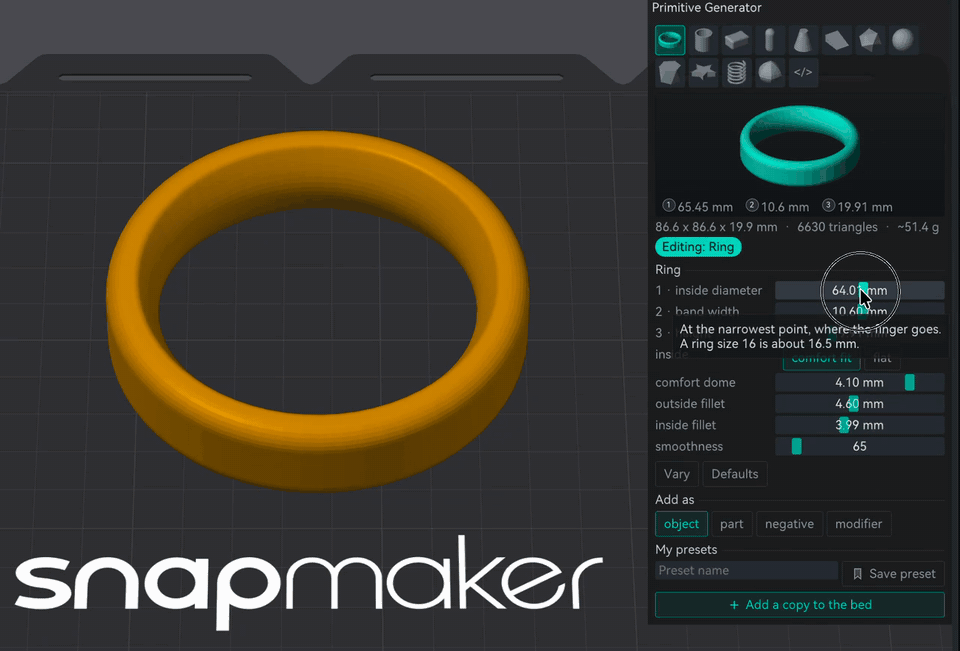
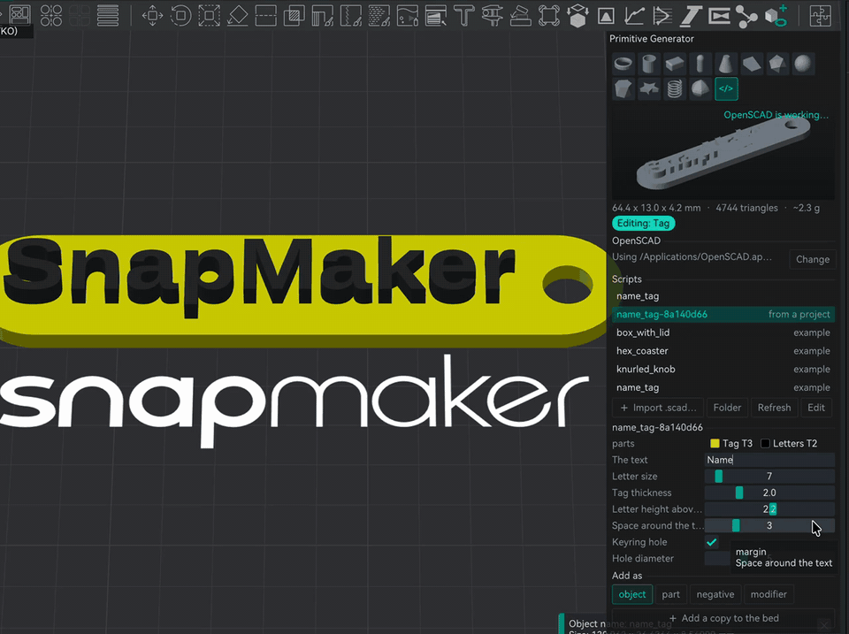

## Proud to announce that @Snapmaker is officially sponsoring this project!!

Development is conducted in close collaboration with the Snapmaker ecosystem and with Radoux/Radu, author of FullSpectrum and now part of the Snapmaker team.
By Neotko — inventor of Ironing/Neosanding (Ultimaker Cura, PrusaSlicer)

---

# Neotko 2.5.0 — on Snapmaker Orca 2.4.0 — Release Notes (draft, in progress)

> ⚠️ **Review your generated Gcode before long or production prints, especially if you
> turn on any of the features below.**

**2.5.0 is an incremental release on top of 2.4.9** (see `NEOTKOCM_RELEASE_2_49.md` and earlier
notes for the full feature set).

2.5.0 turns the painter into a small drawing and sculpting studio: draw with natural brushes, give
the drawing volume with Clay, carve it into the object, and keep all of it through a Remesh.

---

## What's new in 2.5.0

### The painter, reorganised

**Where**: the painter (Color painting). Three tabs on top: **Brush** (key **B**), **Vector** (key **V**),
**Clay** (key **K**), plus **Vector Brush** (key **P**).

- One **Decals** list shared by Vector and Clay. Every layer has an **eye** (show or hide) and a **lock**
  (no moving or editing by accident). **Shift + click** marks several layers.
- **A small bar on the canvas**, over the selected decal: move, ✓ done, pencil (edit), drop (paint it on
  the object). It stays see-through until you put the mouse on it.
- While you edit on screen, a floating **✓ / ✕** accepts or cancels, so you don't have to go back to the
  panel.
- **Merge N layers**: Shift + click two or more layers and merge them into one decal. Each colour keeps its
  filament. Only for layers placed from almost the same view (15° or less), you get a warning otherwise.
- **Duplicate**: copies the selected layer right under it, same place and settings.
- **Mirror** buttons are now icons: left/right, front/back and up/down. Green = on, the tooltip says which
  plane.
- **Through depth** (Vector, with Depth Through): how deep the paint goes through the object. With
  15 to 20 mm the colour reaches the walls and the bottom of a hollow without coming out at the back.
- The mouse wheel is always the camera, also while you drag a decal.

### Vector Brush

**Where**: the painter, **Vector Brush** tab (key **P**).

Draw free hand on the object and the stroke comes out smooth and natural, like a drawing app. The tick
saves the strokes as a vector decal, so it gets colours, mirror and Clay like any SVG.

- **Quill** stroke engine (default): exact quadratic curves with few nodes. Method by
  **Gabriel Suchowolski (microbians)**, MIT: <https://github.com/microbians/bezier>,
  <https://github.com/microbians/sktch>, maths at <https://microbians.com/math>.
- **Styles**: Natural, Quill ink, Pen, Marker, Dirty ink, with Width (Speed, Ink, Constant), Inertia
  and Drops.
- **Each stroke keeps its own knobs and its own filament.** Change Size, Style or the filament and only the
  next strokes change. Paint hair in one colour, switch filament and paint a clean line over it, then
  press the tick once: you get one decal with one zone per filament. Where strokes overlap, the newest one
  wins, the way layers work in a drawing app.
- **Tool**: Brush (free hand), **Line** (click point by point, click and drag pulls out a curve, Alt for a
  corner, Enter or a click on the first point finishes it), **Wrap** (Experimental, see below) and
  **Eraser** (key **E**).
- **Eraser**: erases every stroke it goes over, whatever its filament, and never destroys anything: **Undo
  stroke** brings it back (one pass = one step). **Alt + click** a stroke to edit its knobs.
- **Ctrl+Z** inside the brush takes back the last stroke or point, not the decal you saved before.
- **Preview** box under the knobs: the next stroke as it will come out with these settings, in the
  filament's colour.
- The view stays put while there are unsaved strokes, so they land where you drew them. An orange line
  says so.

### Brush effects

**Where**: Vector Brush, **Effect**. A drop down with a live picture of every effect.

| Effect | What it does | Knobs |
|---|---|---|
| Plain | the stroke as it is | |
| Hair / fur | strands that grow out of the stroke | Density, Length, Root, Lean, Randomness |
| Stipple | the stroke made of dots | Density, Dot size, Edge falloff |
| Dashed | dashes and gaps along the stroke | Dash, Fill |
| Grass | blades standing up from the stroke | Density, Length, Root, Sway, Randomness |
| Calligraphy | a flat nib: thin along its angle, thick across | Nib angle, Thin stroke |
| Dither edge | a solid core whose edge breaks into dots | Halo, Density, Dot size, Falloff |

- Every effect is still a vector: the tick saves it as a decal, so it gets Clay, mirror and colours.
- For two colours, layer two strokes (see *each stroke keeps its own filament* above).
- ⚠️ Dots and strands thinner than one line (about 0.4 mm on the object) may not print. Use a bigger
  Dot size, or check the slice.

### Clay Tool (Experimental)

**Where**: the painter, **Clay** tab (key **K**).

Raise your decals off the surface as real parts, or carve them into the object. Each colour of the decal
becomes its own part with that colour's filament, so it slices like any other part.

- **Height** for the whole decal, plus **Height per colour** (the general Height scales them all).
- **Raise / Engrave / Off** per colour. Engrave makes one negative part per decal, with a step where two
  depths meet.
- **Apply all engraves** cuts every engrave into the object at once. If the fast boolean fails, a second,
  slower one takes over, and a check makes sure nothing ever loses more volume than the engraves.
- **Anchor raise to engrave** (on by default): a raised colour that sits inside an engrave goes down to the
  bottom of the hole instead of floating.
- **Edge**: Flat, Chamfer or Round, with a **Falloff** for how soft the edge is. The edge follows the SVG
  exactly, so small text slices clean.
- **Surface smooth** (default 0.2 mm): fills the grooves and sinks the bumps under the part (veins on a skull,
  for example). The top always stays at least 0.4 mm over the real surface.
- **Relief warning**: if the surface under the decal has detail finer than your layer height can print, the
  panel tells you.
- **Advanced growth**:
  - **Follow surface**: the part grows along the average shape of the surface in R mm, so it wraps the
    form like a thick sticker. Higher R on uneven surfaces.
  - **Stretch over gaps** and **Stretch slope**: stretches the part like an elastic where the surface jumps
    in depth, instead of leaving wedges.
  - **Min thickness** (default 0.42 mm): where the surface is seen from the side, the part is thickened along
    the surface so the slicer doesn't drop it as a sliver.
- **Freeze** (snowflake in the list): keeps those Clay parts as they are and counts them as part of the
  object, so the Clay of other layers grows on top of them. Unfreezing asks first.
- **X-ray engrave**: shows the negative parts in see-through red while you paint.
- **Repair parts** (off by default): rebuilds each part with voxels, as a safety net when one comes out odd.
- **Living Clay**: parts rebuild by themselves when you move or edit the decal (after you let go of the mouse), in the
  background, with **Cancel**.
- **Detach** turns them into normal parts.
- **Paint under** (off by default): also paints the decal colour on the object under the part. It can help
  the part stick when the raised area is very thin. Leave it off if the decal will move, since the old paint
  stays where it was.
- **Tip for hollows and complex shapes**: Clay can only raise what the decal sees. For a decal that crosses a
  hollow, paint it first in Vector with Depth Through and Through depth 15 to 20 mm, then build the Clay with
  a small Stretch and a high Follow surface. The paint covers what the Clay can't reach.

### Draw on surface and Wrap (Experimental)

**Where**: Vector, **Draw on surface**, and Vector Brush, Tool **Wrap**.

Draw point by point **on** the object instead of on the screen, and turn the view between clicks. The line
wraps round the object.

- Click = corner. Click and drag = curve (Alt: only the way out). Drag a point to slide it along the surface.
- Draw on surface: click the first point for a closed shape, or Enter for an open line with a Width.
- Wrap: an open line whose width is the brush Size, in mm. The preview turns red under 0.4 mm.
- Its Clay grows piece by piece round the object, not from one view.
- For now it is for Clay: **Apply** paints it as seen from its middle.

### Remesh keeps your work (Align & Construct)

Two new options in **Remesh**, both on by default:

- **Keep decals & recipes**: when the whole object is rebuilt, the new one keeps the painter's decals and
  layers (Vector and Clay settings), the mirror centre, the ColorStitch stickers and the object's own
  settings (Sandwich recipes, layer ranges). Surfaces picked by hand for Sandwich can't follow the new
  triangles: the recipe stays, pick the surfaces again.
- **Keep Clay & extra parts**: only the plain parts are rebuilt. Clay parts, engraves (negative parts),
  modifiers and blockers move to the new object as they are, instead of melting into the new skin or
  being lost. No more split, change type and re-assemble before a Remesh.

### Primitive Generator

**Where**: the toolbar, last icon (a cube, a ring and a plus). For everyone, no LibreMode needed.

- **12 shapes with real sizes**, not a cube you scale by eye: ring, tube, rounded box, capsule, cone and
  pyramid, wedge, the five platonic solids, geodesic ball, antiprism, star with twist, spring and
  superformula.
- **The ring is a real ring**: comfort fit (the inside is domed like a wedding band) or flat, its own
  outside and inside fillet, and the inside diameter measured where the finger goes.
- **A live preview** in the panel: drag it to turn it. Size, triangles and grams update as you move a
  slider.
- **Add as** object, part, negative part or modifier. New objects land on a free spot of the bed.
- **Change it later**: select a shape made here and the sliders edit it on the bed, one undo step per
  drag. The numbers are saved in the 3mf.
- **Vary** tries random numbers around yours; **My presets** keeps the ones you like.

### OpenSCAD scripts in the Primitive Generator

**Where**: Primitive Generator, the **</>** tile.

- **Your own `.scad` files, with their Customizer numbers as sliders**: ranges and steps, check boxes,
  drop downs, text and `/* [Groups] */`, the same way the Customizer reads them.
- **Four examples** to start: box with lid, knurled knob, honeycomb coaster and a two colour name tag.
- **Import .scad**, **Folder** and **Edit**: Edit opens the script in OpenSCAD, and when you save it there
  the shape here updates by itself.
- **Multi colour pieces**: a script with a `part` choice (`part = "all"; // [all, tag, letters]`) is drawn
  piece by piece. Each piece becomes a part of the object, on the loaded filament closest to the colour
  the script gives it. Change it later in the object list, mixed filaments included.
- **The 3mf carries its own script.** Open a project made with a script you don't have and the shape can
  still be changed. A script that comes inside someone else's project waits for **Trust and run**.
- OpenSCAD itself is free (openscad.org). The panel finds it in the usual places or lets you point to it.

### MixedFilament Depth recipe (Experimental, extra option)

**Where**: Object & TD panel, under **MixedFilament Object**, check box **Depth recipe**. Off by default.

A mixed filament wall gets its colour from the side, but the top and bottom faces show only the last few
layers over the sparse infill, so they often look darker or different from the walls. Depth recipe fixes
that using each filament's TD (transmission distance).

- **Target = the wall colour** as you see it from the side. **Base = what is really under the top**: the
  sparse infill at your infill density.
- It picks the loaded filaments and how many layers of each go under the top (and over the bottom) to
  get that colour, the same way the Sticker Depth recipe does. It stops as soon as the colour is close
  enough, so it only uses the layers it needs, up to **5 mm** (you can set 0.2 to 10 mm).
- Those layers become solid infill, with the filament of the recipe on each layer.
- **Chamfer**: the coloured zone shrinks inwards at 45° instead of going straight down, and inside it the
  inner perimeters give way to the recipe. The outer perimeter always stays, so the wall colour from the
  mix is untouched. From above, this removes the darker frame the inner perimeters leave.
- The colour maths matches RealView (TD per colour channel, with diffusion), so what RealView shows is
  what the recipe aims at.
- The **Sticker Depth recipe** is now available to everyone too.

### Smoother 3D view with heavy models

Tested with a 5.7 million triangle project (painted skull plus Clay parts) on an M4 Mac.

- **Mac: every frame now reaches the screen.** The 3D view used to draw many frames that macOS never
  showed (about 1 in 5 made it), so rotating felt like 2 to 5 fps even when the app was drawing 20 to 60.
  The view now waits for the screen refresh, and what you see matches what is drawn.
- **Plain view (sun off) is about twice as fast** on big meshes: large parts are drawn with shared
  vertices and back faces are skipped. Same look.
- **Lit view (sun on)**: the shadow is no longer redrawn while you only move the camera, and the shadow
  and depth passes use the lighter mesh. Frame time on the test project went from about 47 ms to 18 ms.
  The lit look is unchanged.
- **Sun icon on the plate**, next to Photo mode and Snap & Drag: one click turns the lit view off or on,
  without leaving LibreMode.
- **The painter is lighter**: with the painter open, the shadow on the bed is no longer drawn (it drew the
  whole mesh a second time every frame).
- **Moving the mouse over the 3D view no longer redraws the whole scene** when nothing under the cursor
  changes.
- **Dragging a part with Snap & Drag is much lighter**: its footprint is computed once per drag and then
  just moved, instead of being rebuilt on every mouse move (from 110 to 210 ms per move down to about
  30 ms on the test project).

---

## Fixes

- **Numbers read the same in any UI language.** With Orca's interface in Spanish, German, French or any
  language that uses a decimal comma, some values stored in the 3mf (for example ColorStitch band widths
  like `6.7845`) were read as whole numbers (`6`) without any warning, so a project could slice
  differently than on the author's machine. They are now read with a dot whatever the language, and
  values an older build saved with a comma still load. If you use Orca in a language other than English
  and something in ColorStitch, NeoStroke or the wipe tower looks different from before, please tell us.
- **Vector decals in a non-English UI**: the SVG made from drawn strokes no longer gets broken numbers
  (`12,34`) when the interface uses a decimal comma.
- **Windows: loading an SVG from a folder with accents or `ñ`** in its path failed with "The SVG file could
  not be read". Fixed, and the decal keeps the file's real name.
- **Painter panels with a lot in them** (long strokes, many effects) drew stray lines across the panel and
  the screen. Fixed.
- **Painter preview colours** follow the filament number, not its place in the list, so they are right
  after you reorder filaments.
- **Draw shape with engraves on the object** showed no points or lines until you applied it. Fixed.
- **Two decals with the same name** fought over their Clay parts and rebuilt in a loop. The second one is
  now renamed (`bloodvein 2`), also when you open an older 3mf.
- **Decals** list: one click folds it (it needed two).
- A rare error while building Clay could close the app. It now shows the error and goes on.
- **Cut on a very dense painted model** (millions of triangles) could leave the slice stuck at 5% for
  minutes. The cut face was getting painted in tiny pieces, and the colour split choked on it. Fixed: the
  cut face stays clean and very heavy outlines are simplified below what the printer can show.
- **Cut connectors are listed** under their piece. Orca kept them hidden, so a cut piece looked like one
  mesh while it carried a connector (and Remesh "found" a negative part). They still can't be moved on
  their own, and deleting one asks first.
- **Cut to parts now works with connectors**: each piece becomes its own object with its connector, left
  where it was. Without connectors it works as before.
- **Sandwich Stickers only print on the face you put them on.** Before, the sticker's outline could also
  colour nearby tops and, with Depth recipe, the edges of the object below. New **Select area** in the
  sticker's Place tab: click the face like a bucket (Angle for how far it spreads, Shift+click adds).
  Without a picked area the slicer guesses the face from the layers.
- **Sticker preview with Depth recipe** shows the colours the recipe will print (**Show: Result**) or the
  ones in the SVG (**Target**), only on the picked area, and updates when you change the recipe.
- **Painter, Per color** (Pro Mode): reopening a 3mf with Extra walls or Surface depth per colour showed the
  checkbox off and the global values, while the print used the per colour ones. Now it comes up on and shows
  the table.
- **Painter, Walls per color on a MixedFilament** (Pro Mode): the extra walls set on a mix were ignored (a skin
  mix with 8 walls printed 2). Now a mix keeps its own walls on every layer, with or without Local Z, and the other
  colours keep theirs. Also fixed: extra walls painted with the object's own filament were dropped, and the
  painted walls could be lost when the slicer refreshed its regions.
- **Slicing with a custom MixedFilament** could close the app at «Generating G-code: layer 1» when one of its
  filaments was only used by the mix on the wipe tower. Fixed. If a filament is ever missing again, the slice
  stops with a message asking for the 3mf instead of closing.

---

## Known limits

- **Undo in the painter**: when you leave the painter, Orca joins everything you did there into one undo
  step. If you go back in and press Ctrl+Z, everything from that visit goes at once.
- **Brush effects with Wrap**: Wrap draws plain strokes for now.
- **Draw on surface** is for Clay: its paint comes from one view.
- **Primitive Generator, OpenSCAD**: OpenSCAD has to be installed for now (a later build ships it inside
  the app). Scripts that use libraries (BOSL2 and similar) need them installed in OpenSCAD, and they don't
  travel inside the 3mf. Without a `part` choice a script comes out as one piece, even with `color()`.
- **MixedFilament Depth recipe** is experimental: checked in RealView, not yet in real prints. With very
  low TD filaments (around 1.5) it may not reach the wall colour, because the layers go in blocks and
  don't alternate. The bottom face itself keeps its own colour; only the solid layers above it change.
  More tool changes, so a bigger wipe tower.
  For now it works on the object's own MixedFilament only: what you paint on top (another filament or
  another MixedFilament) prints as before, without a recipe.
- **Primitive Generator**: changing a shape repaints nothing; painting on a generated shape is lost when
  you change its numbers.
- **Cut with a connector**: the half printed upside down may get support inside the female hole. Add a
  support blocker there.
- **Select area** (stickers): while you pick, the sticker is still drawn on top of the face. Move it aside to
  see the face you are picking. A later build hides it while picking.
- **Heavy painted models**: a very dense mesh with paint can slice very slowly. Remesh it first, or lower
  its detail.

---

## Reference commits

The new painter (Vector Brush with effects, Clay, Draw on surface, the new panel), the Clay core, the Remesh
options, the Primitive Generator and the Cut fixes are also ready as clean commits for other forks to take. The Primitive
Generator panel keeps the Neotko look (its own colours and layout, not Orca's classic gizmo style). Same changes, without the Neotko-only parts (no
Sandwich, no ColorStitch, no lit render, no debug logging). They go on top of the 2.4.9 ones. Syntax-checked on
macOS; **not compiled as a whole, not tested on Windows**.

- Snapmaker Orca 2.4.0: branch [neotko-2_50-sm240](https://github.com/sebsucmor-alt/OrcaFS-NeotkoCM/tree/neotko-2_50-sm240)
- FullSpectrum: branch [neotko-2_50-fullspectrum](https://github.com/sebsucmor-alt/OrcaFS-NeotkoCM/tree/neotko-2_50-fullspectrum)

| Change | Snapmaker Orca 2.4.0 | FullSpectrum |
|---|---|---|
| fix(imgui): draw lists past 65k vertices no longer show stray triangles | [`03d8e52e0`](https://github.com/sebsucmor-alt/OrcaFS-NeotkoCM/commit/03d8e52e0a60d6fd83466b92c4d6e8254745c7dc) | [`9e6c5538b`](https://github.com/sebsucmor-alt/OrcaFS-NeotkoCM/commit/9e6c5538b44f37d1ee9488789503cb19c81d29a0) |
| Clay Tool core, Vector Brush strokes and engrave booleans | [`627b1dd64`](https://github.com/sebsucmor-alt/OrcaFS-NeotkoCM/commit/627b1dd648b6cf8567310ecf39e4f2b40d276798) | [`257031508`](https://github.com/sebsucmor-alt/OrcaFS-NeotkoCM/commit/25703150850c75768b586bff80d76138f7c4bc73) |
| Painter: Vector Brush with effects, Clay tab, Draw on surface, new panel | [`3750e87b5`](https://github.com/sebsucmor-alt/OrcaFS-NeotkoCM/commit/3750e87b5c2e7fdd7660a74acc9e421b6712dc23) | [`d3cf5de1e`](https://github.com/sebsucmor-alt/OrcaFS-NeotkoCM/commit/d3cf5de1e1a81c8c69d51ab8f631943e03d98d92) |
| Align & Construct: Remesh keeps decals, Clay parts and the object's settings | [`31acb609e`](https://github.com/sebsucmor-alt/OrcaFS-NeotkoCM/commit/31acb609ef1899354a572df4a6b5298b7ab6ca51) | [`60971fd92`](https://github.com/sebsucmor-alt/OrcaFS-NeotkoCM/commit/60971fd92016ddb9667d7b5f388bd138e2b7da85) |
| Primitive Generator: parametric shapes and OpenSCAD scripts (Neotko style UI) | [`4d207f487`](https://github.com/sebsucmor-alt/OrcaFS-NeotkoCM/commit/4d207f487bb0454654d09eb84414cb6979b1b9cc) | [`c3231e0e6`](https://github.com/sebsucmor-alt/OrcaFS-NeotkoCM/commit/c3231e0e616245d211d47c6b5b032cd491ee974a) |
| Cut keeps the painting: no more hang on dense painted meshes | [`c65015271`](https://github.com/sebsucmor-alt/OrcaFS-NeotkoCM/commit/c65015271cb73ce5dbc2e4ab84fee673490a9bc1) | [`5e5cb9806`](https://github.com/sebsucmor-alt/OrcaFS-NeotkoCM/commit/5e5cb9806b18e3cafaf55d90fba67903c6d564b8) |
| Cut: connectors are listed as parts, Cut to parts works with connectors | [`3cf555403`](https://github.com/sebsucmor-alt/OrcaFS-NeotkoCM/commit/3cf55540318d6ed160369170d9fee84051bb7fb7) | [`ff4d09707`](https://github.com/sebsucmor-alt/OrcaFS-NeotkoCM/commit/ff4d09707150c649b3fc19d9fb4e9c480677d8e1) |
| Painter: «Per color» shows on when the 3mf has per colour values | [`959bae905`](https://github.com/sebsucmor-alt/OrcaFS-NeotkoCM/commit/959bae905c76bbdb5490f2d91a48c8f19aac7b4a) | [`d2eef836a`](https://github.com/sebsucmor-alt/OrcaFS-NeotkoCM/commit/d2eef836a93f36064bfac705cddc249a3d4a3e70) |
